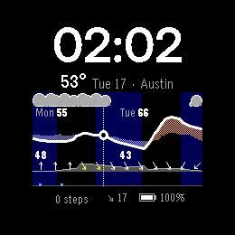
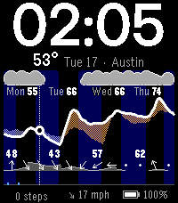
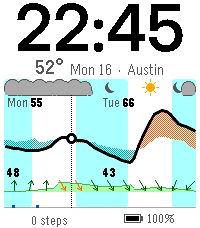
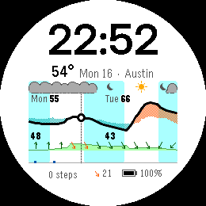
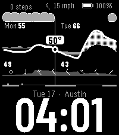
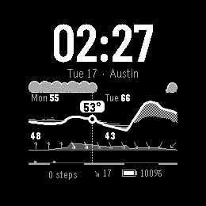

# Weatherline

Weatherline is a watchface for Pebble Time 2 (emery) and Pebble Round 2 (gabbro). It draws an hour-by-hour forecast with the time, the place, today's steps, the battery, and the Bluetooth state.

Both watches share one centered layout with the time near the bottom: steps, the current wind and the battery along the top, then the chart. On Time 2 a large time comes next, with the date and the place under it; on Round 2 the date and the place sit above the time, where the round screen is still wide enough for them.

The line is the face. Its color follows the temperature: white when mild, cyan when cool and blue below freezing, orange when warm and coral when hot (darker tones in the light theme; in Mono the line grows thicker as it warms instead). An orange ring marks now, and the current temperature rides the line beside it in a small tag filled with the line's color there. The tag sits above the ring, or below or beside it when a day label is in the way.

The temperature is the phone's latest reading while it is under an hour old. After that the watch shows the forecast for the current hour, and the current wind always comes from the forecast for the current hour, so both stay right when the phone stops refreshing in the background. When the clock runs past the whole forecast, the ring and tag go away and the last temperature joins the date line, grayed.

A band along the line shows how today compares with the same hour yesterday: orange below the line where it will be warmer, blue above it where it will be colder, so warm and cold fronts stand out. Only a lasting change counts: the difference from yesterday is averaged over seven hours, so one cloudy or sunny afternoon does not look like a front. The band is 3 pixels per degree Celsius of that average, up to 12 pixels, and fades in between 1 °C and 2 °C (about 2 to 4 °F), so a front swells in and out with the change instead of switching on, and the same thickness means the same change on any day. Yesterday never stretches the chart's scale. Night hours sit on a dark blue band behind the chart that fades in and out over a few pixels at dusk and dawn. A lane along the top shows the sky as a bank of puffy clouds that grows taller with cloud cover; where the lane is empty, the sky is clear. Below the chart, a wind lane shades wind speed in gray (full at 50 km/h, about 31 mph) and places a wind barb every few hours. A barb's staff points to where the wind comes from, and the feathers at its tip give the speed in knots: a short feather is 5, a long one 10 and a filled pennant 50. A small ring means calm. Barbs snap to eight compass points so every stroke lands on whole pixels. Rain is a bar per hour along the bottom, taller when heavier, and snow is a stack of flakes. Each day is labeled with its high and low, and with its name when more than one day is shown.

The time is set in Barlow Condensed SemiBold, included under the SIL Open Font License (`resources/fonts/OFL.txt`). AM and PM, the now ring and the settings page share one orange accent.

Screenshots are color-corrected for the real panel.

| Time 2 | Round 2 |
| --- | --- |
|  |  |
|  |  |
|  |  |
|  |  |

The top row shows today's steps, the current wind as a barb and a speed (mph with Fahrenheit, km/h with Celsius), and the battery. The center of that row can instead show the local time of the last forecast that arrived, chosen in settings. A red Bluetooth sign appears left of the time (top center on Round 2) when the phone is disconnected.

## The screen

Both watches have a reflective color screen: it is lit by the room or the sun, which keeps it readable outdoors and lets it stay on all day, but it shows colors much softer than a phone does. Pale tints land almost on white and oranges turn peach, so every color on the face was chosen by how it looks after the SDK's panel color correction (`pebble screenshot` applies it by default), not by its nominal value. Shading fills three pixels in four so it keeps its color, the temperature line is 3 pixels wide, and the now line is solid. Light reads best in daylight; Dark suits dim rooms and the backlight.

## Build

From this directory, run:

```
pebble build
```

The SDK is Pebble 4.x. `package.json` keeps `sdkVersion` at `"3"`, which is what the tool expects.

## Test

The phone-side code has tests that run on Node 18 or later:

```
node --test tests/*.cjs
```

The watch layout lives in `src/pkjs/frame.js`. After changing it, regenerate the C header with `node scripts/emit-layout.js`.

## Install

Install on an emulator with:

```
pebble install --emulator emery
pebble install --emulator gabbro
```

Install on a phone at a known address with:

```
pebble install --phone <ip>
```

## Settings

Open the config page from the Pebble phone app.

- Days shown are 1, 2, 3, or 5. The default is 2.
- The temperature unit is °F or °C. The default is °F.
- The temperature line can plot **Actual** air temperature (default) or **Feels like** (apparent) temperature. When the chart range crosses freezing (32°F / 0°C), a faint dotted reference line marks freezing.
- Refresh is every 30 minutes, 45 minutes, 1 hour, 2 hours, or 3 hours. The default is 1 hour.
- The theme is Dark, Light or Mono. The default is Dark. Mono uses only black, white and grays: warmer than yesterday is a bright checker, colder is gray horizontal lines, and night is a light bar under the chart instead of a band behind it. The low-battery and Bluetooth warnings stay red.
- The top-left and top-center slots beside the battery are each configurable. Both offer **Feels like**, **Humidity**, **UV index**, **Sunrise / sunset** (next upcoming event), or **Off**. The top left also offers **Steps** (its default). The top center also offers **Wind speed** (its default) and **Last updated** (refresh mark + local time of last successful fetch).
- **Bluetooth disconnect alert** optionally triggers a brief double-buzz if the phone stays disconnected for 3 seconds (silent during Quiet Time).
- **Location** can be **Automatic** (default) or a **Fixed city** (searchable by city name via Open-Meteo geocoding or entered as `lat, lon`), which skips phone geolocation completely.

Changing display settings redraws the forecast already stored on the phone without downloading again, and the watch applies them without a restart. During a Pebble Timeline Quick View, the face automatically switches to a compact layout so the time, current temperature, date, and top row remain readable above the Quick View card.

The phone tries a network location first (accepting fixes up to 15 minutes old), reuses a recent cached fix instead of waking GPS indoors, and only falls back to GPS if no fix from the last 6 hours is available. The watch asks the phone for a refresh only when its stored forecast is missing or past the configured refresh interval (and stays silent over Bluetooth during Quiet Time while the forecast still covers the current hour). To save watch and phone battery, the phone persists its last refresh timestamp and frame hash across restarts so returning to the watchface does not re-check location or resend an unchanged frame, bit-packs hourly records to shrink Bluetooth transfers and flash writes, looks up the place name only when the location changes, and caches the static chart on the watch so normal minute ticks repaint only the time band. If a refresh fails, the watch keeps showing the last forecast, and the temperature follows the forecast hour by hour until it runs out.

## Credits

[Weather data by Open-Meteo.com](https://open-meteo.com/) (CC BY 4.0). Place names by [BigDataCloud](https://www.bigdatacloud.com/). The time is set in [Barlow Condensed](https://github.com/jpt/barlow), copyright 2017 The Barlow Project Authors, under the SIL Open Font License (`resources/fonts/OFL.txt`).

Full notices are in [CREDITS.md](CREDITS.md). The code is MIT, copyright 2026 Alec Hudson.
