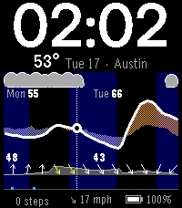
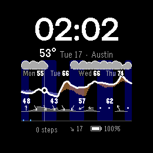

# Weatherline

Weatherline is a watchface for Pebble Time 2 (emery) and Pebble Round 2 (gabbro). It draws an hour-by-hour forecast with the time, the place, today's steps, the battery, and the Bluetooth state.

Both watches share one centered layout: a large time, one line with the current temperature, the date and the place, then the chart, then steps, the current wind and the battery.

The temperature is the phone's latest reading while it is under an hour old. After that the watch shows the forecast for the current hour, and the current wind always comes from the forecast for the current hour, so both stay right when the phone stops refreshing in the background. The temperature turns gray only once the clock has run past the whole forecast.

The chart is a temperature line with a ring marking now. The area between the line and the same hour yesterday is shaded apricot where it will be warmer and periwinkle where it will be colder (orange and indigo in the light theme), so warm and cold fronts stand out. Night hours sit on a dark blue band behind the chart. A lane along the top shows the sky as a bank of puffy clouds that grows taller with cloud cover; where the lane is empty, the sky is clear. Below the chart, a wind lane shades wind speed in gray (full at 50 km/h, about 31 mph) and places an arrow every few hours pointing the way the wind blows; arrows turn yellow at about 30 km/h (19 mph) and calm hours get a dot. Rain is a bar per hour along the bottom, taller when heavier, and snow is a stack of flakes. Each day is labeled with its high and low, and with its name when more than one day is shown.

The time is set in Inter Display SemiBold, included under the SIL Open Font License (`resources/fonts/OFL.txt`).

| Time 2 | Round 2 |
| --- | --- |
|  |  |
|  |  |
|  |  |

The bottom row shows today's steps, the current wind with an arrow the way it blows (mph with Fahrenheit, km/h with Celsius), and the battery. A red Bluetooth sign appears at the top right (top center on Round 2) when the phone is disconnected.

## Build

From this directory, run:

```
pebble build
```

The SDK is Pebble 4.x. `package.json` keeps `sdkVersion` at `"3"`, which is what the tool expects.

## Test

The phone-side code has tests that run on Node 18 or later:

```
node --test tests/*.cjs
```

The watch layout lives in `src/pkjs/frame.js`. After changing it, regenerate the C header with `node scripts/emit-layout.js`.

## Install

Install on an emulator with:

```
pebble install --emulator emery
pebble install --emulator gabbro
```

Install on a phone at a known address with:

```
pebble install --phone <ip>
```

## Settings

Open the config page from the Pebble phone app. There are four settings.

- Days shown are 1, 2, 3, or 5. The default is 2.
- The temperature unit is °F or °C. The default is °F.
- Refresh is every 30 minutes, 45 minutes, or 1 hour. The default is 1 hour.
- The theme is Dark or Light. The default is Dark.

Changing the day count, the unit, or the theme redraws the forecast already stored on the phone. It does not download again.

The phone tries a network location first, then GPS, and keeps the last fix. The watch also asks the phone for a refresh every half hour and when Bluetooth reconnects, so the forecast stays current even if the phone pauses the app in the background. If a refresh fails, the watch keeps showing the last forecast. The temperature turns gray when the forecast is more than two hours old.

## Data

Forecasts come from [Open-Meteo](https://open-meteo.com/) and are licensed under [CC BY 4.0](https://creativecommons.org/licenses/by/4.0/). Place names come from the BigDataCloud reverse geocoder. Neither service needs an API key.
